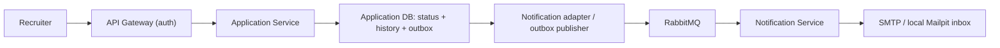

# Application Service API

Owner: Application Service owner (Pun). Local internal address: `http://localhost:3004`. Public address after gateway integration: `http://localhost:8080`. Source of truth: `openapi.yaml` and `contracts/application.status.changed.v1.schema.json`. GitHub repository: [rolefit-application-service](https://github.com/Tiramisu-SA/rolefit-application-service).

## Scope and flow

This implements BUC-2C application submission and BUC-3 reads/status changes. Resume generation, match computation, deadline reminders, and other notification types belong to their owners or remain outside this task. Read operations return stored snapshots and never read another service's private database or compute fresh match results.



## Identity and ownership

| Header         | Required             | Source                                                                  |
| -------------- | -------------------- | ----------------------------------------------------------------------- |
| `X-User-Id`    | Always               | Gateway's verified JWT subject                                          |
| `X-User-Role`  | Always               | Gateway's verified `app_metadata.role`, exactly `seeker` or `recruiter` |
| `X-Company-Id` | Every recruiter call | Trusted company identity, preferably verified `app_metadata.company_id` |

Missing user/role or recruiter company returns 401. Unsupported roles return 403. Seeker reads are restricted to the owning candidate. Recruiter reads/updates are restricted to the application's stored company. Request bodies cannot override identity, candidate, or company. The service does not verify JWTs; it trusts the private gateway boundary. It has no hardcoded company fallback.

## REST reference

| Method and path                                 | Caller                             | Response                                                       |
| ----------------------------------------------- | ---------------------------------- | -------------------------------------------------------------- |
| `POST /api/applications`                        | Seeker                             | `201 { application: Application }`, with `Location` read path  |
| `GET /api/applications/mine`                    | Seeker                             | `{ applications: Application[] }` for that user                |
| `GET /api/applications?jobId=...`               | Recruiter                          | `{ applications: Application[] }`, filtered by job and company |
| `GET /api/applications/:applicationId`          | Owning seeker or company recruiter | `{ application: Application }`                                 |
| `PATCH /api/applications/:applicationId/status` | Owning company recruiter           | `{ application: Application, notificationQueued: boolean }`    |
| `GET /health`                                   | Internal, no identity required     | `{ status: "ok", service: "application" }`                     |
| `GET /ready`                                    | Internal, no identity required     | `{ status, database, broker }`                                 |

Lists are ordered by latest `updatedAt`, then ID. This prototype returns the complete filtered list without pagination. Listing applicants for an unknown or unowned job returns an empty list; this endpoint does not claim to verify job existence upstream. Reading/updating a known application owned by someone else returns 403; unknown application IDs return 404.

### Submit application

`POST /api/applications` accepts `{ jobId, coverLetter? }`. Only a seeker may submit. `jobId` matches `[A-Za-z0-9_-]{1,100}`; `coverLetter` is optional text up to 10,000 characters, trimmed, and required when the job requires it. The existing 16 KiB JSON limit applies. Extra fields, including candidate identity, recipient email, resume content or match scores, are rejected.

The gateway supplies verified `X-User-Id` (UUID), `X-User-Role: seeker`, and preserves `Authorization: Bearer <token>`. Application checks header/token shape, does not verify or decode JWTs, and forwards the token to owning services that require it. A client-supplied `X-Company-Id` is never forwarded on seeker service calls.

Submission performs these reads before writing:

1. Job Posting gRPC `rolefit.jobposting.v1.JobPostingService/GetJob`, `{ job_id }`, at `JOB_POSTING_GRPC_URL` (default `localhost:50052`). Copy of the owner's **dev** protocol is in `proto/job-posting.proto`; default `main` currently contains an older incomplete protocol. Require `JOB_STATUS_OPEN`, a company/title, and an unexpired application deadline if set.
2. Resume Preparation gRPC `rolefit.resumepreparation.v1.ResumePreparationService/GetApprovedResume`, `{ candidate_id: verifiedUserId, job_id }`, at `RESUME_PREPARATION_GRPC_URL` (default `localhost:50053`). Its unchanged `main` protocol is copied to `proto/resume-preparation.proto`. Only the returned included sections are saved. Missing or unapproved resumes reject submission.
3. Job Discovery REST `GET /api/jobs/:jobId/match`, at `JOB_DISCOVERY_SERVICE_URL` (default `http://localhost:3002`). The response is the **bare MatchResult**, with `jobId`, `candidateId`, `score`, `breakdown`, `matchedSkills`, `missingSkills`, `strengths`, `gaps`, `explanation`, and `computedAt`; not `{ match: ... }`. Require the returned job/candidate to match the request. The consumer JSON Schema is `contracts/match-result.v1.schema.json`.
4. Candidate Profile REST `GET /api/profiles/me`, at `CANDIDATE_PROFILE_SERVICE_URL` (default `http://localhost:3001`). Read only `id`, `name`, and `email` from its bare profile response. This supplemental lookup is needed because resume/match contracts contain no contact information. Require the profile owner to match the verified seeker and a name/valid email; never invent contact data.
5. In one Application DB transaction, insert the application at `Submitted` and one initial history entry attributed to the seeker. A unique `(candidate_id, job_id)` index prevents duplicate/concurrent applications. No outbox event or email is created for initial submission.

All service calls forward only `Authorization`, `X-User-Id`, and `X-User-Role` (lowercase gRPC metadata equivalents). The gateway remains the public authenticator. Resume's current internal gRPC handler has no JWT verification, so its port must remain private. No private upstream database is accessed.

`resumeReference` stores `{ draftId, format, approvedAt, updatedAt }`; new `resumeSnapshot` stores the full normalized approved resume, including its sections/bullets. The schema is `contracts/approved-resume.v1.schema.json`. `matchSnapshot` preserves the full MatchResult plus `summary` (same as `explanation`) and `capturedAt`. Candidate and job snapshots are copied at submission. `coverLetter` is the supplied trimmed text or null. Legacy seeded applications retain null resume/match snapshots. Reads and status changes never refresh these snapshots.

Illustrative internal request (not a gateway/JWT-verified example):

```http
POST /api/applications
X-User-Id: 11111111-1111-4111-8111-111111111111
X-User-Role: seeker
Authorization: Bearer <gateway-verified-token>
Content-Type: application/json

{"jobId":"job_seed_frontend"}
```

Each upstream call has `UPSTREAM_TIMEOUT_MS` (default 5,000 ms). gRPC and streamed REST responses are bounded to 2 MiB. Responses are validated and safe fields selected; malformed/mismatched results fail closed. Configure TLS with `UPSTREAM_GRPC_TLS=true` and an optional `UPSTREAM_GRPC_CA_FILE` when needed; HTTPS verifies certificates normally. No production stub mode or fallback data is enabled.

These reads and the local DB commit cannot form one transaction across service databases. Snapshots reflect the successful reads; an upstream edit/closure immediately after a read can race submission. Application rechecks the returned deadline before persistence, but does not claim an atomic job/resume reservation.

### Read application

`GET /api/applications/:applicationId` already exists and now includes stored `resumeSnapshot` and `coverLetter`. Access remains restricted to the owning seeker or recruiter company. It reads status/history consistently from one database statement and makes no upstream calls, including when the job closes or the original resume is edited afterward.

### Status update

Illustrative request, not a gateway-authenticated run:

```http
PATCH /api/applications/app_demo_brightline/status
X-User-Id: recruiter-demo
X-User-Role: recruiter
X-Company-Id: co-brightline
Content-Type: application/json

{"status":"Under review","note":"Review started"}
```

Statuses, including exact casing: `Submitted`, `Under review`, `Interview`, `Offer`, `Rejected`. Any change between these values is allowed, matching the existing frontend behavior. `note` is optional, max 2000 characters; surrounding whitespace is trimmed. Unknown body fields and invalid JSON are rejected. `jobId` must be a nonempty string of at most 200 characters. JSON request bodies are limited to 16 KiB.

The response contains the full updated application, including history, plus `notificationQueued: true` when an outbox event was committed. This does **not** mean RabbitMQ or SMTP has already accepted it. Setting the current status returns `notificationQueued: false` and does not alter history, timestamp, or notes.

Application fields are `id`, `jobId`, `companyId`, `candidateId`, `candidate` (`id`, `name`, `email`), `jobSnapshot` (`id`, `title`, `companyId`), nullable `resumeReference`, nullable `resumeSnapshot`, nullable `matchSnapshot`, nullable `coverLetter`, `status`, ISO-8601 UTC `submittedAt`/`updatedAt`, and `history` (`status`, `at`, `changedBy`, nullable `note`). Existing snapshots are preserved. Local seed fixtures have null resume/match snapshots and are not real submissions.

### Errors

All errors use `{ "error": { "code": "...", "message": "..." } }`.

| HTTP | Code                                             | Meaning                                                                                 |
| ---- | ------------------------------------------------ | --------------------------------------------------------------------------------------- |
| 400  | `VALIDATION_ERROR`                               | Invalid status, note, query, JSON, extra field, or oversized body                       |
| 401  | `MISSING_IDENTITY`                               | Required verified identity header missing                                               |
| 403  | `FORBIDDEN`                                      | Unsupported role or caller does not own the application                                 |
| 404  | `APPLICATION_NOT_FOUND`                          | Unknown application ID                                                                  |
| 404  | `ROUTE_NOT_FOUND`                                | Unsupported endpoint                                                                    |
| 409  | `NOTIFICATION_DATA_INVALID`                      | Stored recipient/job snapshot cannot form a valid notification                          |
| 401  | `MISSING_AUTHORIZATION`                          | Submission bearer token not forwarded                                                   |
| 401  | `UPSTREAM_UNAUTHENTICATED`                       | Upstream rejected forwarded identity                                                    |
| 404  | `JOB_NOT_FOUND`                                  | Job does not exist or is not visible                                                    |
| 409  | `ALREADY_APPLIED`                                | This seeker already applied to this job (including concurrent requests)                 |
| 409  | `JOB_NOT_OPEN` / `APPLICATION_DEADLINE_PASSED`   | Job is closed/draft or deadline passed                                                  |
| 409  | `COVER_LETTER_REQUIRED`                          | Required cover letter missing                                                           |
| 409  | `RESUME_DRAFT_NOT_FOUND` / `RESUME_NOT_APPROVED` | No approved resume available                                                            |
| 409  | `PROFILE_REQUIRED` / `PROFILE_INCOMPLETE`        | Profile missing or lacks name/valid email                                               |
| 502  | `UPSTREAM_ERROR` / `UPSTREAM_RESPONSE_INVALID`   | Upstream failed or returned malformed/mismatched data; nothing saved                    |
| 503  | `SERVICE_UNAVAILABLE`                            | Database/upstream unavailable or timeout; application or status transaction rolled back |

Broker outage does not return 503 for an otherwise valid status update: the event remains in the database outbox. `/ready` returns 200/degraded for broker outage and 503/unavailable for database outage.

## Gateway-owner checklist

- Add `APPLICATION_SERVICE_URL` (`http://localhost:3004` locally; an internal hostname in deployment).
- Add seeker-only `POST /api/applications` to the existing four read/status routes. Submission must forward the verified bearer token unchanged; allow 30 seconds for the four sequential 5-second upstream budgets plus persistence. Keep the public/internal submission path unchanged. Preserve method, query, JSON body, error shape, status code, and response. Do not route notification health ports publicly.
- Authenticate with the existing Supabase verifier before proxying. Replace or remove **all** client-supplied `X-User-Id`, `X-User-Role`, and `X-Company-Id` headers.
- Inject user and role from verified claims. For recruiters inject company from trusted verified metadata. If company assignment is unavailable, fail closed; do not trust a client header or use a company fallback.
- Preserve `/api/applications` upstream: public `PATCH /api/applications/:id/status` maps to internal `PATCH /api/applications/:id/status`.
- Confirm the proxy preserves the entire `/api/applications` path, including root POST and query handling. A generic rewrite to `/api${remainingPath}` would lose `applications`.
- Enforce recruiter role for PATCH and applicant-list calls; enforce seeker role for `/mine`. Application repeats ownership/role checks.
- Keep Application/Notification ports reachable only by trusted internal callers; loopback bindings here are for local development. Forwarded headers alone do not protect a publicly exposed service.
- Test forged identity headers, wrong-company writes, seeker writes, query preservation, normal service errors, and downstream unavailability. This repository does not modify gateway code. The published gateway documentation currently lists the four existing routes; the new submission route requires its owner to integrate and test it.

## Event contract

Exchange `rolefit.events` (durable topic); key `application.status.changed.v1`; durable queue `notification.application-status.v1`. Persistent JSON messages have AMQP `messageId = eventId` and `contentType = application/json`. Schema version is 1.

Illustrative payload:

```json
{
  "eventId": "26ec5af5-7cef-434b-9fe9-dc4f37e00455",
  "schemaVersion": 1,
  "eventType": "application.status.changed.v1",
  "occurredAt": "2026-10-11T00:00:00Z",
  "applicationId": "app_demo_brightline",
  "jobId": "job_seed_frontend",
  "candidateId": "seeker-demo",
  "recipient": {
    "name": "Sample candidate",
    "email": "seeker-demo@example.test"
  },
  "jobTitle": "Frontend Engineer (sample)",
  "previousStatus": "Submitted",
  "newStatus": "Under review"
}
```

No resumes, match results, bearer tokens, or recruiter notes are published. Additional event properties are rejected. The outbox retries after broker recovery, so consumers must deduplicate `eventId`. Publisher confirmation means the broker accepted a routed message, not that an email was delivered.

## Local example

Seed first with `docker compose exec application node dist/src/seed.js`, then:

```sh
curl -X PATCH http://localhost:3004/api/applications/app_demo_brightline/status   -H 'X-User-Id: recruiter-demo'   -H 'X-User-Role: recruiter'   -H 'X-Company-Id: co-brightline'   -H 'Content-Type: application/json'   -d '{"status":"Under review"}'
```

This direct internal call tests trusted-header authorization, not JWT authentication. Inspect captured email at `http://localhost:8025`. Rerunning an identical status change does not send another email.

## Local port coordination

Job Discovery uses REST 3002. Job Posting's published HTTP health default also uses 3002; when running both on the host, give Job Posting's health-only listener another port with `HTTP_PORT` (for example 3012), while keeping its gRPC port 50052. Application calls its gRPC endpoint, not its health HTTP port. Owner configurations are unchanged by this task.
