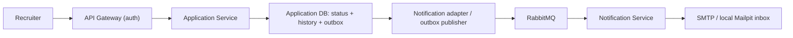

# Application Service API

Owner: Application Service owner (Pun). Local internal address: `http://localhost:3004`. Public address after gateway integration: `http://localhost:8080`. Source of truth: `openapi.yaml` and `contracts/application.status.changed.v1.schema.json`. GitHub repository: [rolefit-application-service](https://github.com/Tiramisu-SA/rolefit-application-service).

## Scope and flow

This implements BUC-3 status changes for already persisted applications. Submission, resume generation, matching, deadline reminders, and other notifications are excluded. Read operations return stored snapshots and never read another service's private database or compute fresh match results.



## Identity and ownership

| Header         | Required             | Source                                                                  |
| -------------- | -------------------- | ----------------------------------------------------------------------- |
| `X-User-Id`    | Always               | Gateway's verified JWT subject                                          |
| `X-User-Role`  | Always               | Gateway's verified `app_metadata.role`, exactly `seeker` or `recruiter` |
| `X-Company-Id` | Every recruiter call | Trusted company identity, preferably verified `app_metadata.company_id` |

Missing user/role or recruiter company returns 401. Unsupported roles return 403. Seeker reads are restricted to the owning candidate. Recruiter reads/updates are restricted to the application's stored company. Request bodies cannot override identity, candidate, or company. The service does not verify JWTs; it trusts the private gateway boundary. It has no hardcoded company fallback.

## REST reference

| Method and path                                 | Caller                             | Response                                                       |
| ----------------------------------------------- | ---------------------------------- | -------------------------------------------------------------- |
| `GET /api/applications/mine`                    | Seeker                             | `{ applications: Application[] }` for that user                |
| `GET /api/applications?jobId=...`               | Recruiter                          | `{ applications: Application[] }`, filtered by job and company |
| `GET /api/applications/:applicationId`          | Owning seeker or company recruiter | `{ application: Application }`                                 |
| `PATCH /api/applications/:applicationId/status` | Owning company recruiter           | `{ application: Application, notificationQueued: boolean }`    |
| `GET /health`                                   | Internal, no identity required     | `{ status: "ok", service: "application" }`                     |
| `GET /ready`                                    | Internal, no identity required     | `{ status, database, broker }`                                 |

Lists are ordered by latest `updatedAt`, then ID. This prototype returns the complete filtered list without pagination. Listing applicants for an unknown or unowned job returns an empty list; this endpoint does not claim to verify job existence upstream. Reading/updating a known application owned by someone else returns 403; unknown application IDs return 404.

### Status update

Illustrative request, not a gateway-authenticated run:

```http
PATCH /api/applications/app_demo_brightline/status
X-User-Id: recruiter-demo
X-User-Role: recruiter
X-Company-Id: co-brightline
Content-Type: application/json

{"status":"Under review","note":"Review started"}
```

Statuses, including exact casing: `Submitted`, `Under review`, `Interview`, `Offer`, `Rejected`. Any change between these values is allowed, matching the existing frontend behavior. `note` is optional, max 2000 characters; surrounding whitespace is trimmed. Unknown body fields and invalid JSON are rejected. `jobId` must be a nonempty string of at most 200 characters. JSON request bodies are limited to 16 KiB.

The response contains the full updated application, including history, plus `notificationQueued: true` when an outbox event was committed. This does **not** mean RabbitMQ or SMTP has already accepted it. Setting the current status returns `notificationQueued: false` and does not alter history, timestamp, or notes.

Application fields are `id`, `jobId`, `companyId`, `candidateId`, `candidate` (`id`, `name`, `email`), `jobSnapshot` (`id`, `title`, `companyId`), nullable `resumeReference`, nullable `matchSnapshot`, `status`, ISO-8601 UTC `submittedAt`/`updatedAt`, and `history` (`status`, `at`, `changedBy`, nullable `note`). Existing snapshots are preserved. Local seed fixtures have null resume/match snapshots and are not real submissions.

### Errors

All errors use `{ "error": { "code": "...", "message": "..." } }`.

| HTTP | Code                        | Meaning                                                           |
| ---- | --------------------------- | ----------------------------------------------------------------- |
| 400  | `VALIDATION_ERROR`          | Invalid status, note, query, JSON, extra field, or oversized body |
| 401  | `MISSING_IDENTITY`          | Required verified identity header missing                         |
| 403  | `FORBIDDEN`                 | Unsupported role or caller does not own the application           |
| 404  | `APPLICATION_NOT_FOUND`     | Unknown application ID                                            |
| 404  | `ROUTE_NOT_FOUND`           | Unsupported endpoint, including submission                        |
| 409  | `NOTIFICATION_DATA_INVALID` | Stored recipient/job snapshot cannot form a valid notification    |
| 503  | `SERVICE_UNAVAILABLE`       | Storage failure; status/history/outbox transaction rolled back    |

Broker outage does not return 503 for an otherwise valid status update: the event remains in the database outbox. `/ready` returns 200/degraded for broker outage and 503/unavailable for database outage.

## Gateway-owner checklist

- Add `APPLICATION_SERVICE_URL` (`http://localhost:3004` locally; an internal hostname in deployment).
- Route exactly the four business endpoints above. Preserve method, query, JSON body, error shape, status code, and response. Do not route notification health ports publicly.
- Authenticate with the existing Supabase verifier before proxying. Replace or remove **all** client-supplied `X-User-Id`, `X-User-Role`, and `X-Company-Id` headers.
- Inject user and role from verified claims. For recruiters inject company from trusted verified metadata. If company assignment is unavailable, fail closed; do not trust a client header or silently use the gateway's current dev company default.
- Preserve `/api/applications` upstream: public `PATCH /api/applications/:id/status` maps to internal `PATCH /api/applications/:id/status`.
- The existing `createServiceProxy` helper strips its mount prefix and adds `/api`. Mounted at `/api/applications`, its current rewrite would wrongly produce `/api/:id/status`. Customize the rewrite to `/api/applications${remainingPath}` (including root/query handling) or preserve the complete original pathname/query.
- Enforce recruiter role for PATCH and applicant-list calls; enforce seeker role for `/mine`. Application repeats ownership/role checks.
- Keep Application/Notification ports reachable only by trusted internal callers; loopback bindings here are for local development. Forwarded headers alone do not protect a publicly exposed service.
- Test forged identity headers, wrong-company writes, seeker writes, query preservation, normal service errors, and downstream unavailability. Gateway integration is not implemented or claimed by this repository.

## Event contract

Exchange `rolefit.events` (durable topic); key `application.status.changed.v1`; durable queue `notification.application-status.v1`. Persistent JSON messages have AMQP `messageId = eventId` and `contentType = application/json`. Schema version is 1.

Illustrative payload:

```json
{
  "eventId": "26ec5af5-7cef-434b-9fe9-dc4f37e00455",
  "schemaVersion": 1,
  "eventType": "application.status.changed.v1",
  "occurredAt": "2026-10-11T00:00:00Z",
  "applicationId": "app_demo_brightline",
  "jobId": "job_seed_frontend",
  "candidateId": "seeker-demo",
  "recipient": {
    "name": "Sample candidate",
    "email": "seeker-demo@example.test"
  },
  "jobTitle": "Frontend Engineer (sample)",
  "previousStatus": "Submitted",
  "newStatus": "Under review"
}
```

No resumes, match results, bearer tokens, or recruiter notes are published. Additional event properties are rejected. The outbox retries after broker recovery, so consumers must deduplicate `eventId`. Publisher confirmation means the broker accepted a routed message, not that an email was delivered.

## Local example

Seed first with `docker compose exec application node dist/src/seed.js`, then:

```sh
curl -X PATCH http://localhost:3004/api/applications/app_demo_brightline/status   -H 'X-User-Id: recruiter-demo'   -H 'X-User-Role: recruiter'   -H 'X-Company-Id: co-brightline'   -H 'Content-Type: application/json'   -d '{"status":"Under review"}'
```

This direct internal call tests trusted-header authorization, not JWT authentication. Inspect captured email at `http://localhost:8025`. Rerunning an identical status change does not send another email.
